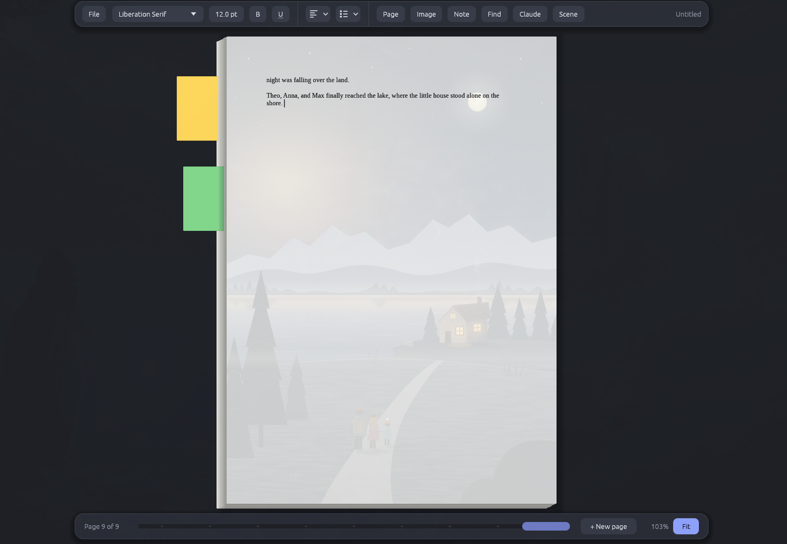
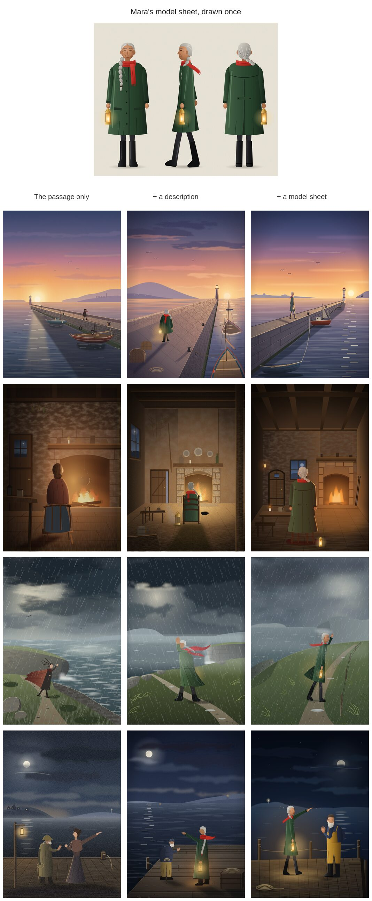

# Caprice

**A word processing app for creative, fun story telling.**

Caprice is a word processor for writing stories, not reports. It gives you real pages that turn like a book’s or slide onto a stack, post-it notes for your ideas, and Claude as a helper: it can paint the scene you are writing behind the page, or read along when you circle a passage.



## Why Caprice

- **Easy to use.** One small toolbar, real pages and no clutter. Start typing, and the story fills page after page.
- **A welcome to come back to.** Opened without a file, Caprice greets you with a page of its own: begin something new, or pick up one of the stories you opened last, each shown with its first page, its first words, how many words it holds and when you last had it open. Choose one and its sheet flies onto the desk and becomes the page.
- **Joy in writing.** Pages turn over like a book’s, or slide onto a stack (pick the look under Page → View: *Book* or *Paperstack*). Under Page → Theme, the desk and docks come in seven moods: *Midnight Ink*, *Lagoon*, *Marmalade*, *Disco Grape*, *Bubblegum*, *Pistachio Sorbet* and *Typewriter*; the new one washes in over the old. The pages you have already written pile up beside the one you are on, so you can watch the story grow.
- **Room for ideas.** Stick post-its to any line for plot twists, names and "what if…" thoughts. They peek out of the page piles, and clicking one takes you back to its page.

## Features

- **Begin a story as a kind.** A *Blank page*; a *Novel* on 6 × 9 in book pages, justified, with chapter titles, drop caps and page numbers, starting at "Chapter One"; a *Manuscript* in typewriter type, double spaced, to send out; or a *Journal* on A5 with today’s date as its first title. Each sets up the paper, type and headers and footers; change any of it later as usual.
- **Scenes behind the page.** Describe a place ("a village between the mountains and the sea, at dusk") and Claude paints it faintly behind your writing. Or let it follow along, painting each paragraph as you finish it. Every scene is kept with its part of the story, and the picture changes as your caret moves on. You can save a picture as a PNG or SVG.
- **The same people in every scene.** Describe the people of your story once under Scene → Cast (a name, other names the story uses for them, how they look), and let Claude draw each one a model sheet. Every scene whose passage names them then paints them from it, so Mara looks like Mara in every picture of the book, though the story never says again how she looks. A paragraph that only says "she" or "the boy" is painted with whoever the paragraph before named, and the list of scenes shows who each scene was painted with, to choose others and paint it again. Someone who changes over the story can keep several looks (as a girl, after the shipwreck), each with its own description and sheet; switch which one is in use, and scenes painted from then on show that one.

  
- **Circle to ask Claude.** Turn on the pen (Ctrl+Shift+P) and draw a loop around a passage. Claude can review it, fix awkward wording, check grammar, summarize it, or answer your own question about it. A rewrite can replace the passage, and one undo brings the original back.
- **Post-it notes** on any selection or line (Ctrl+Alt+N), in several colours.
- **Leafing through pages** with the scrollbar at the bottom, a two-finger swipe or Page Up / Page Down. In *Paperstack*, dragging the scrollbar slides each page it passes halfway out, and letting go moves them all together.
- **Pictures** in your text that you can move, resize and rotate.
- **Page numbers** in Page > Page numbers, for the page you are on: show them or not, type a new number to start counting again (figures or roman), and see every page where that changes. No footer with numbers yet? One click adds it.
- **Formatting** that stays out of the way: fonts, sizes, bold, italic, underline, text colour, alignment, lists and page setup; the brush copies formatting from one place to another.
- **Chapters with drop caps.** The first letter of a chapter sinks two or three lines deep, and the text flows around it, the next paragraphs too; a letter with a tail (j, p, q, y) is sized to keep it within those lines.
- **Search and replace** (Ctrl+F, Ctrl+H), with match case and whole words, to rename someone across the whole story in one go (and one undo).
- **Document info** (File → Document info): words of the story, the chapter and the selection, when the story was begun and last saved, its versions, and the words written today towards a daily goal.
- **Undo** and **zoom** (Ctrl + / − / 0).
- **Your work is safe.** A story with a file saves itself half a minute after each change; closing still lets you keep the changes or drop them back to how you last saved it. Before you leave a story with changes, Caprice tells you what is at stake: its words and chapters, how much changed since you saved it and when. A story never saved is offered a file name from its first chapter or first words. And every story, saved or not, keeps earlier versions of itself, even when you choose not to save: go back to one under File → Versions, where stories never saved can be opened again too.
- **Export to Word** (.docx) when the story is ready to share.
- **Print** (Ctrl+P) on any printer set up on your Mac or Linux machine, or save the pages as a PDF, looking just as they do on screen.

## Getting started

Caprice is written in Rust and runs on Linux and macOS.

```sh
cargo run --release              # try it: the welcome page
cargo run --release -- story.caprice   # open a story directly
./install.sh                     # install it: a launcher entry on Linux, an app in ~/Applications on macOS
```

On Linux, `install.sh` places the binary in `~/.local/bin` and adds a launcher entry and icon under `~/.local/share`.

On macOS, it builds `~/Applications/Caprice.app` (no sudo needed), so Caprice shows up in Launchpad and Spotlight and opens `.caprice` files by double-click. Re-run `./install.sh` after pulling updates to refresh it.

### Claude features

The scene painting and the pen use [Claude Code](https://claude.com/claude-code) on your machine. Install it and sign in by running `claude` once in a terminal. Caprice stores no keys of its own; it runs your local `claude` command with tools, project settings and session history turned off. Everything else in Caprice works without Claude.

## Files

Stories are saved as `.caprice` files: plain JSON holding the text, notes, pictures, the scenes behind the pages and the cast.

Caprice keeps its own things in its data folder (`~/.local/share/caprice` on Linux, `~/Library/Application Support/Caprice` on macOS): the versions of every story, the list of stories last opened for the welcome page, your daily word goal and the theme you picked.
